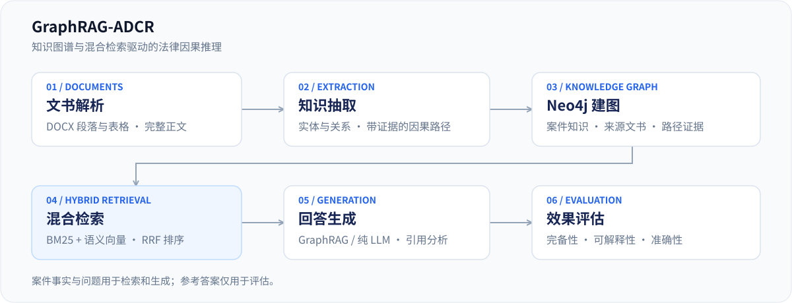

<div align="center">

# GraphRAG-ADCR

**自动驾驶事故 · 法律因果推理 · 可追溯类案检索**

以知识图谱与混合检索组织类案证据，支持法律因果分析与责任认定。

[快速开始](#快速开始) · [方法流程](#方法流程) · [输入说明](#输入说明) · [结果查看](#结果查看)

</div>



> 本项目为论文 [A GraphRAG Approach to Enhancing the Ability of Causal Reasoning in Autonomous Driving Cases](https://doi.org/10.3233/FAIA251625) 的配套实现。

## 方法流程

从司法文书构建案件知识图谱，通过关键词与语义混合检索获取类案及因果路径，生成带来源证据的责任分析，并与纯 LLM 回答进行比较。

| 阶段 | 功能 | 对应代码 |
| :--- | :--- | :--- |
| ① 解析 | 提取 DOCX 文书中的段落与表格 | `adcr/ingestion/docx_parser.py` |
| ② 抽取 | 识别实体、关系及带原文证据的因果路径 | `adcr/ingestion/extract_kg.py` |
| ③ 建图 | 将案件知识与来源证据写入 Neo4j | `adcr/graph/build_graph.py` |
| ④ 检索 | 融合 BM25 与语义向量，排序类案及因果路径 | `adcr/retrieval/retrieve.py`、`adcr/retrieval/embeddings.py` |
| ⑤ 生成 | 生成纯 LLM 回答和带引用的 GraphRAG 回答 | `adcr/generation/generate.py`、`adcr/common/evidence.py` |
| ⑥ 评估 | 计算指标、核验引用，生成逐案对比与报告 | `adcr/evaluation/evaluate.py`、`adcr/evaluation/metrics.py` |

GraphRAG 回答包含类案匹配、因果链、引用、责任主体和法律依据。参考答案用于评估，不参与生成。

## 快速开始

### 1. 准备环境

需要 **Python 3.9+**、**Neo4j 5+** 及可用的模型 API。以下 PowerShell 命令在项目根目录执行：

```powershell
python -m venv .venv
.\.venv\Scripts\python.exe -m pip install -r requirements.txt
Copy-Item .env.example .env
Copy-Item examples/testset.json testset.json
New-Item -ItemType Directory -Force corpus | Out-Null
```

### 2. 填写配置

编辑 `.env` 并启动 Neo4j：

| 配置 | 用途 | 配置要求 |
| :--- | :--- | :--- |
| `DEEPSEEK_API_KEY` / `DEEPSEEK_MODEL` | 知识抽取及两组回答生成 | 填写 Key 和模型名称 |
| `DEEPSEEK_BASE_URL` | OpenAI 兼容生成接口 | 按所用服务调整 |
| `NEO4J_URI` / `NEO4J_USER` / `NEO4J_PASSWORD` / `NEO4J_DATABASE` | 图数据库连接 | 填写密码，其余按数据库配置调整 |
| `ZHIPU_API_KEY` / `ZHIPU_MODEL` / `ZHIPU_BASE_URL` | 独立评判接口 | 可选；留空 Key 时仅计算离线指标 |
| `EMBEDDING_MODEL` / `EMBEDDING_REVISION` | 本地语义编码 | 默认 BGE 模型；也可指定本地目录及版本 |

默认语义模型为 `BAAI/bge-small-zh-v1.5`，首次使用需下载权重，缓存位于 `.cache/models/`。

### 3. 放入输入

- 将 `.docx` 文书放入 `corpus/`。
- 按 `examples/testset.json` 填写待分析案件，保存为 `testset.json`。
- 评估时填写参考答案和检索相关性标注。

### 4. 一键运行

```powershell
.\.venv\Scripts\python.exe run.py
```

终端按六个阶段显示进度，结果保存在 `output/`。重新运行同一命令可复用有效缓存、重试失败项。

## 输入说明

### 待分析案件

`testset.json` 的结构如下，字段示例见 `examples/testset.json`：

```json
{
  "cases": [
    {
      "id": "example",
      "case_type": "交通事故责任纠纷",
      "facts": "车辆发生碰撞，原因及责任主体尚待查明。",
      "question": "需要哪些证据分析事故因果关系与责任？"
    }
  ]
}
```

每个案件的 `id` 应唯一。按需要补充以下字段：

| 可选字段 | 内容 | 用途 |
| :--- | :--- | :--- |
| `legal_context` | 法律版本、适用时间等前提 | 明确法律语境 |
| `reference_answer` | 完整参考答案 | 文本比较、模型评分和定性分析 |
| `reference.responsible_parties` | 责任主体数组 | 主体 P / R / F1 |
| `reference.law_articles` | 法条名称数组 | 法条 P / R / F1 |
| `reference.liability_conclusion` | 责任结论 | 结论一致性评价 |
| `relevant_case_ids` | 相关语料文件名，不含扩展名 | 检索 P@3 / R@3 / MRR |

离线指标按已填写的参考字段计算。模型评分包括完备性、可解释性和准确性，需要配置评判接口。

### 人工标注与法规资源

- **案件标注**：执行 `python -m adcr.graph.annotations export`，将抽取结果导出至 `annotations/cases/`，对照原文核验。
- **法规资料**：创建 `annotations/` 目录，将 `examples/laws.json` 复制为 `annotations/laws.json`，填写法规原文、版本和来源。

标注字段和法规格式见 [标注说明](docs/annotations.md)。

## 结果查看

| 文件 | 内容 |
| :--- | :--- |
| `output/evaluation_report.md` | **优先查看**：整体指标、逐案比较及引用证据 |
| `output/comparison.csv` | 逐案指标表，可用 Excel 打开 |
| `output/baseline_results.json` | 纯 LLM 回答与结构化结果 |
| `output/graphrag_results.json` | GraphRAG 回答、引用及检索快照 |
| `output/retrieval_cache.json` | 类案匹配、因果路径和原文证据 |
| `output/evaluation_details.json` | 评分依据、调用状态及失败原因 |

`data/parsed/` 保存正文，`data/extracted/` 保存抽取结果。评估核验回答对应的检索快照，分别判断来源是否存在、内容是否相关、是否支持论点。

<details>
<summary><strong>项目结构与运行配置</strong></summary>

```text
GraphRAG-ADCR-V2/
├── adcr/
│   ├── ingestion/     # 文书解析与知识抽取
│   ├── graph/         # 图谱构建与标注
│   ├── retrieval/     # 混合检索与向量编码
│   ├── generation/    # 回答生成
│   ├── evaluation/    # 评分与指标
│   ├── common/        # 模型接口、存储与证据
│   └── config.py      # 项目配置
├── docs/              # 文档与图片
├── examples/          # 输入模板
├── scripts/           # 维护工具
├── tests/             # 测试
└── run.py             # 运行入口
```

默认检索前 **3** 个类案，每案最多 **2** 条因果路径，在 `adcr/config.py` 中设置 `TOP_K` 和 `PATHS_PER_CASE`。

BM25 与语义检索通过加权 RRF 融合，默认两路权重各 `0.5`。可通过 `.env` 中的 `HYBRID_KEYWORD_WEIGHT`、`HYBRID_SEMANTIC_WEIGHT`、`HYBRID_RRF_K` 和 `HYBRID_CANDIDATES` 调整排序参数。

长文按 token 滑窗编码，分块长度和重叠量由 `EMBEDDING_CHUNK_TOKENS`、`EMBEDDING_CHUNK_OVERLAP` 设置。

模型接口默认直连；需要继承环境代理时设置 `LLM_TRUST_ENV=true`。接口不支持关闭思考参数时，设置 `LLM_DISABLE_THINKING=false`。

</details>

## 许可

[CC BY-NC 4.0](LICENSE)。
